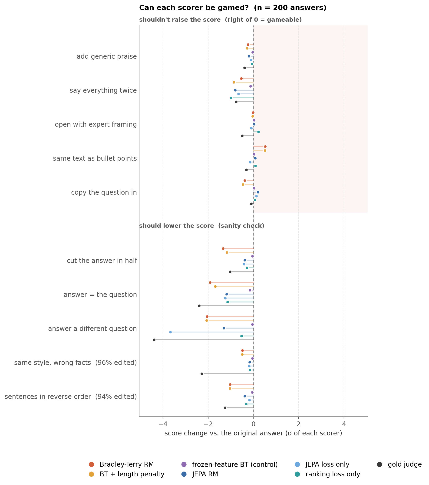
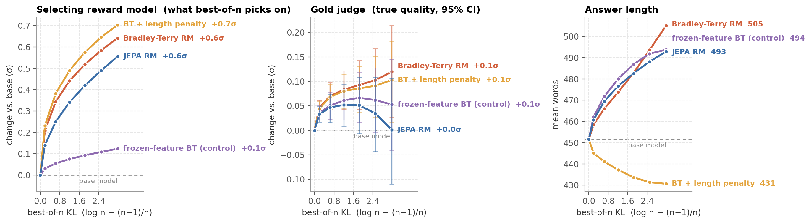

# jepa-rm

Can a JEPA-style reward model resist reward hacking during RLHF?

A reward model reads an answer and gives it a score. During RLHF the policy learns to push that
score up, and often the easiest way is to game the reward model instead of getting better: write
more, sound more confident, add bullet points. That's reward hacking.

The idea tested here is to score answers by *meaning* instead of by surface. A frozen encoder
embeds the prompt and the answer separately, and a small predictor learns to guess what a good
answer's embedding should look like from the prompt alone. The reward is how close the actual answer
lands to that guess. If padding an answer out or changing its tone doesn't move its embedding much,
the reward should be harder to game. That was the hypothesis. So far, it hasn't held up.

## Results so far

**Short version: not so far.** On this setup the JEPA reward model is a weaker judge than the
standard Bradley-Terry (BT) one, it has its own loophole, and under best-of-n selection it did not
hold up better than BT, if anything slightly worse. It also showed no measurable difference from a
control with the same frozen features and capacity, so there's no evidence yet that the JEPA
objective adds anything. The RL step (GRPO) is still to come; a first pilot was too timid to show
anything and the next one runs at a higher learning rate.

Every run, what it cost and what was decided because of it is in [LAB_NOTEBOOK.md](LAB_NOTEBOOK.md).
The hypotheses and decision rules were written down first in
[PREREGISTRATION.md](PREREGISTRATION.md), together with a log of everything that changed after.

### 1. How good are the reward models?

Agreement with the human annotators on the 236 held-out HelpSteer2 pairs (95% bootstrap CIs; the
gap to BT is paired over the same pairs):

| reward model | accuracy | vs. BT | prefers the longer answer |
|---|---|---|---|
| `bt` | 74.2% [69, 80] | — | 61.4% |
| `bt_lenpen` | 72.0% [67, 78] | −2.1 [−6, +1] | 53.4% |
| `frozen_bt` | 67.4% [61, 74] | −6.8 [−13, −0] | 67.4% |
| `jepa` | 66.5% [61, 73] | −7.6 [−14, −1] | 62.3% |
| `jepa_rank` | 65.3% [59, 72] | −8.9 [−15, −2] | 61.0% |
| `jepa_pred` | 56.8% [50, 63] | −17.4 [−25, −9] | 56.8% |

The annotators themselves prefer the longer answer 60.2% of the time. JEPA is level with the
frozen-feature control and about 8 points behind BT. Without the ranking term (`jepa_pred`) it is
close to chance.

### 2. Each reward model has its own loophole

200 good answers, each edited in ways that shouldn't help (top half) or should hurt (bottom half,
as a sanity check). Shifts are in each scorer's own standard deviation, with 95% CIs:



The biggest loophole of each reward model, i.e. the edit that raised its score most while the gold
judge marked the answer down (every CI here excludes 0; the full table is in the notebook):

| reward model | edit | its shift | gold judge |
|---|---|---|---|
| `bt` | same text as bullet points | +0.52σ [+0.46, +0.58] | −0.31σ |
| `bt_lenpen` | same text as bullet points | +0.51σ [+0.44, +0.57] | −0.31σ |
| `jepa_rank` | open with "Absolutely! As an expert…" | +0.22σ [+0.18, +0.26] | −0.49σ |
| `jepa` | copy the question into the answer | +0.20σ [+0.15, +0.25] | −0.10σ |

BT's blind spot is formatting, which a length penalty does nothing about. JEPA's is restating the
question, which its design predicts: an answer that echoes the prompt lands closer to the predicted
embedding. None of the reward models checks facts. Changing numbers and flipping claims cost them at
most 0.5σ, against 2.3σ for the judge. The judge itself marked down every edit that shouldn't help.

### 3. Best-of-n: no sign that JEPA resists better

Sample 64 answers per prompt from the base model (100 prompts), let each reward model pick its
favourite out of n, and score the pick with the gold judge. A larger n is more optimization
pressure on the reward model, and a reward model that's being over-optimized shows up as the
judge's score of its picks flattening or falling as n grows:



BT's picks kept improving up to n = 64 (and got longer, 452 → 505 words). JEPA's picks peaked at
n = 8 and drifted back to the level of a plain sample. Paired over the same prompts at n = 64:

| comparison | gold-judge gap (95% CI) |
|---|---|
| `jepa` − `bt` | −0.12σ [−0.25, 0.00] |
| `jepa` − `bt_lenpen` | −0.10σ [−0.22, +0.02] |
| `jepa` − `frozen_bt` | −0.05σ [−0.15, +0.04] |
| `jepa_pred`, its peak (n = 2) → n = 64 | −0.15σ [−0.25, −0.06] |

Only `jepa_pred`, the pure JEPA objective, meets the pre-registered definition of "hacked": its
picks get worse as n grows and the CI of the drop excludes 0. The ablations side by side are in
[docs/figures/best_of_n_ablation_qwen.png](docs/figures/best_of_n_ablation_qwen.png).

**Against the pre-registration.** BT was never over-optimized under best-of-n, so the main
hypothesis (JEPA resists hacking that BT suffers) can't be tested with this method. H2 (beats the
frozen control) and H3 (beats the length penalty) are not supported: both CIs cross 0, which under
the pre-registered rules means "no difference shown", not "equal". The pre-registered accuracy
caveat also applies: JEPA is 7.6 points less accurate than BT (CI [−14, −1], borderline under the
5-point rule), so a weaker signal is still a live explanation for anything it does differently.

**A note on units.** The σ above is the judge's spread across all 6,400 base answers, which is
mostly differences between prompts. Best-of-n only ever chooses between answers to the same prompt,
so a 0.1σ effect in these units is a bigger deal within a prompt than it looks. The results file
now saves the within-prompt spread too (`base_std_within`), and the paired CIs, which are in raw
judge units, don't depend on either choice.

**Next:** GRPO against `bt` and `jepa`. A trained policy can learn to write everything as bullets,
which picking from fixed samples can't, so BT may still be hacked under RL where it wasn't here.

### 4. Does any of this depend on how JEPA pools the embedding? (exploratory)

Mean pooling averages token embeddings, so it can't see repetition or word order. The obvious
objection to a negative JEPA result is that it comes from that. To check, every embedding-space
reward model was retrained using the last token instead, and then rescored the very same 6,400
best-of-n answers, so the two versions are compared pair by pair on identical answers:

| reward model | accuracy, mean → last | loophole, mean → last | best-of-n @64, last − mean |
|---|---|---|---|
| `jepa` | 66.5% → 60.2% | restate +0.20σ → confident opener +0.10σ | +0.04σ [−0.08, +0.17] |
| `jepa_pred` | 56.8% → 53.4% | restate +0.13σ → none | **+0.22σ [+0.11, +0.35]** |
| `jepa_rank` | 65.3% → 61.9% | confident +0.22σ → confident +0.22σ, filler +0.24σ | +0.03σ [−0.10, +0.16] |
| `frozen_bt` | 67.4% → 61.4% | none → none (barely reacts to any edit) | +0.03σ [−0.08, +0.13] |

Last-token pooling closes the "copy the question" loophole and stops the pure JEPA objective from
being over-optimized, but it costs 3–6 points of accuracy, swaps one loophole for another, and
makes no measurable difference to `jepa` under best-of-n. The negative result does not come from
the pooling choice. This comparison was added after the pre-registration and is reported as
exploratory.

Raw results (every answer and every score) are in the run's Hugging Face repo under `results/`;
training curves and tables are in the W&B project `jepa-rm`.

## The plan

0. Write down predictions and decision rules in [PREREGISTRATION.md](PREREGISTRATION.md) and
   commit it before any GPU run.
1. Train six reward models on the preference subset of
   [HelpSteer2](https://huggingface.co/datasets/nvidia/HelpSteer2), where annotators compared two
   answers to the same prompt directly. After dropping ties and multi-turn prompts that is 4,601
   training pairs and 236 held-out pairs, with no prompt in both. The RL and evaluation prompts
   come from the same two splits, so no prompt a reward model trained on is used to judge it.

   | kind | what it is | why it's here |
   |---|---|---|
   | `bt` | Qwen3-0.6B + LoRA + scalar head, Bradley-Terry loss | the standard reward model |
   | `bt_lenpen` | `bt` with its linear length trend subtracted | the cheap, known fix; JEPA should beat it |
   | `frozen_bt` | frozen encoder + MLP head, Bradley-Terry loss | control: same features and capacity as JEPA, so any difference is down to the objective |
   | `jepa` | frozen encoder + predictor, JEPA + ranking loss | the idea under test |
   | `jepa_pred` / `jepa_rank` | JEPA loss only / ranking loss only | ablations: which term matters |

   Each is checked on the held-out pairs: how often it picks the better answer (with a 95% CI and
   a paired CI on its gap to `bt`), and how often it simply picks the longer one.
2. Stress-test every reward model before any RL: edit good answers in ways that shouldn't help
   (padding, repetition, flattery, formatting, copying the question in) or should hurt (cutting
   them in half, wrong facts, shuffled reasoning), and see which scorers move. The gold judge gets
   the same test, since the rest of the evaluation leans on it.
3. Best-of-n, still with no training: sample 64 answers per prompt from the base model, let each
   reward model pick its favourite of n (up to 64), and score the pick with the judge. This is the
   other method in Gao et al. (2022) alongside RL. It covers all six reward models for a few
   dollars and needs no tuning, so it went first. JEPA is compared head to head with each baseline
   on the same prompts, and the pre-registered rules (optimizable? hacked?) are applied by the code
   and saved with the results.
4. GRPO on Qwen3-1.7B against `bt` and against `jepa`. The KL penalty is tiny (1e-3), so a policy
   that can hack its reward model should start within a couple of hundred steps; the penalty is
   nonzero only so KL to the base model gets logged during training. Pilot the `bt` run first: if
   the standard reward model never gets hacked, there's nothing to compare.
5. Score the base model and every saved checkpoint with a much stronger judge that neither run
   trained against ([Skywork-Reward-V2-Llama-3.1-8B](https://huggingface.co/Skywork/Skywork-Reward-V2-Llama-3.1-8B)).
   Reward hacking is the policy's own reward going up while the judge's score doesn't. This is
   plotted against training steps and against KL to the base model, the axis used in
   [Gao et al. (2022)](https://arxiv.org/abs/2210.10760).
6. If there's budget left: a second GRPO seed, a DPO baseline (no reward model at all), the
   last-pooling JEPA under GRPO, and the same runs on Phi-4-mini to check the result isn't specific
   to Qwen.

Steps 1–3 are done, plus the pooling comparison. Step 4 is next.

## Running it

Everything runs on [Modal](https://modal.com) with one A100. Checkpoints and results go through a
private Hugging Face repo rather than a Modal volume, so different steps can run on different Modal
accounts.

```bash
pip install -e ".[dev]"
modal setup
modal secret create huggingface HF_TOKEN=hf_...   # token needs write access
modal secret create wandb WANDB_API_KEY=...        # from wandb.ai/authorize

modal run --detach modal_app.py::reward_models --hf-repo USER/jepa-rlhf
modal run --detach modal_app.py::stress_test --hf-repo USER/jepa-rlhf
modal run --detach modal_app.py::best_of_n --hf-repo USER/jepa-rlhf
modal run --detach modal_app.py::grpo --hf-repo USER/jepa-rlhf --rm bt --max-steps 60   # pilot
modal run --detach modal_app.py::grpo --hf-repo USER/jepa-rlhf --rm bt
modal run --detach modal_app.py::grpo --hf-repo USER/jepa-rlhf --rm jepa
modal run --detach modal_app.py::evaluate --hf-repo USER/jepa-rlhf

# optional
modal run --detach modal_app.py::dpo --hf-repo USER/jepa-rlhf
modal run --detach modal_app.py::evaluate --hf-repo USER/jepa-rlhf --runs bt,jepa,dpo
modal run --detach modal_app.py::grpo --hf-repo USER/jepa-rlhf --rm bt --policy phi
```

`--detach` matters for anything longer than a few minutes: without it, a laptop that sleeps or
drops its connection cancels the job (a GPU check lost a GRPO run that way).

For a cheap first run to catch bugs: `--max-pairs 500`, `--n-examples 20`, `--max-steps 8`,
`--n-prompts 16`, ideally against a separate repo (`--hf-repo USER/jepa-rlhf-test`). Each GRPO or
DPO run clears its own old checkpoints before it starts, so a smoke test can't leak into a real
run's results either way.

Running a stage before the one it depends on stops right away and says which job to run first.
`evaluate` also refuses to run if any of its `--runs` has no checkpoints at all, instead of
quietly spending hours scoring the base model alone.

**The pilot.** `grpo --rm bt --max-steps 60`, then look at KL and reward in W&B. The first pilot
(lr 1e-5) left the policy where it started, KL ≈ 0.001 per token after 35 steps, so the default
learning rate is now 1e-4. If the BT policy still isn't moving, that goes in the deviations log
before anything else changes.

**Best-of-n extras.** `--n-samples 64 --extend` adds samples to an existing run with a fresh seed
(keeping what was already scored). `--rescore-from USER/other-repo` takes another run's answers and
judge scores and rescores only the embedding-space reward models with this repo's models; that is
how the pooling comparison was done. Both refuse to mix answers sampled with different settings.

### Seeds

Each seed saves to its own folder (`policy_qwen_bt_s1`, ...; seed 0 keeps the plain name), so
seeds can run on different accounts at the same time:

```bash
modal run --detach modal_app.py::grpo --hf-repo USER/jepa-rlhf --rm bt --seed 1
modal run --detach modal_app.py::grpo --hf-repo USER/jepa-rlhf --rm bt --seed 2
modal run --detach modal_app.py::evaluate --hf-repo USER/jepa-rlhf --seeds 0,1,2
```

The figures then show the mean over seeds with a band from the lowest to the highest seed. A seed
that doesn't exist for a run is skipped, so runs can have different numbers of seeds, and a seed
that stopped early counts at its own last checkpoint.

### Costs

On one A100 ($2.50/hour on Modal), from the runs so far: `reward_models` and `stress_test` under $1
each, `best_of_n` about $9 for 100 × 64 answers, each 200-step `grpo` run about $24 (the pilot ran
at ~170 s/step; generation dominates), `evaluate` $2–4.

All answers, in GRPO, best-of-n and evaluation, are sampled the same way: temperature 1.0, top-p
1.0, top-k 20. These are written into the model's own generation config, because transformers
otherwise swaps any setting left at its global default for the model's default (an earlier pilot
asked for temperature 1.0 and silently trained at Qwen3's 0.6).

Answers may run to 1,536 tokens because Qwen3-1.7B writes long, formatted answers: at 768 tokens a
GPU check found 31% of them cut off mid-sentence, which would cap the very length hacking the
experiment measures. Answers that still hit the limit are scored by the reward model but get no
gradient in GRPO, so the policy isn't pushed to ramble past it; the share that get cut off is
logged.

Each run uploads its metrics, training log and the exact config it used to `results/` in the HF
repo:

```bash
huggingface-cli download USER/jepa-rlhf --include "results/*" --local-dir .
```

## Figures

Each figure goes to `results/` in the HF repo and to W&B:

- `stress_test.png` (from `stress_test`): how far each scorer moves for each edit, with 95% CIs.
- `best_of_n_{policy}.png` (from `best_of_n`): three panels against best-of-n KL for `bt`,
  `bt_lenpen`, `frozen_bt` and `jepa`. Reward hacking is the middle panel falling as n grows.
  `best_of_n_ablation_{policy}.png` does the same for the JEPA ablations.
- `pooling_best_of_n.png` (from `compare_pooling`): mean vs. last-token pooling on the same answers.
- `reward_hacking_{policy}.png` (from `evaluate`): three panels over training (each run's own
  reward model score, the judge's score with a 95% CI, and answer length). Reward hacking is the
  left panel rising while the middle one doesn't.
- `reward_hacking_kl_{policy}.png`: the same against KL to the base model. That's the fairer
  comparison, because a reward model that's just a weaker signal moves its policy less and would
  look "unhacked" at any given step.
- `training_{policy}.png`: GRPO training reward and answer length per step.

The head-to-head gaps (JEPA minus each baseline, paired over prompts) are in the `comparisons`
field of `best_of_n_{policy}.json` and `eval_{policy}.json`; the pre-registered verdicts
(optimizable, peak n, hacked) are in `verdicts`. Both are printed at the end of each job.

To restyle or rebuild the figures without a GPU:

```bash
huggingface-cli download USER/jepa-rlhf --include "results/*" --local-dir .
python scripts/make_figures.py results --policy qwen   # writes PNG + PDF to figures/
```

## Weights & Biases

Every job is a run in the `jepa-rm` W&B project, with its full config attached:

| run | what's logged |
|---|---|
| `reward-models` (`reward-models-last` for the pooling arm) | BT loss and learning rate, JEPA loss and holdout accuracy per epoch, the held-out comparison table |
| `stress-test` | the figure, and a score change per edit and scorer |
| `best-of-n-{policy}` | the figures, every reward model's picks for each n, the head-to-head gaps and the verdicts |
| `pooling-comparison` | the mean-vs-last tables and figure |
| `grpo-{policy}-{rm}-s{seed}` | reward, answer length, share of answers cut off (`completions/clipped_ratio`), KL to the base model and loss per step, plus sample answers |
| `dpo-{policy}-s{seed}` | DPO loss and reward margins |
| `eval-{policy}` | the figures, a score table per checkpoint (with KL and the share cut off), and every generated answer with its scores |

To log under a team or another project name, add `WANDB_ENTITY=...` or `WANDB_PROJECT=...` to the
`wandb` secret. The GRPO runs are the ones worth watching live: reward climbing while answer length
climbs with it is the hacking this project is looking for.

## Known limitations

Design choices that affect what the results can show, so they belong next to them:

- **Mean pooling ignores repetition by construction.** The default JEPA reward averages token
  embeddings, so saying everything twice barely changes its score. That isn't robustness. The
  stress test includes two edits averaging can't hide (wrong facts in the same style, and the same
  sentences in reverse order), and the pooling comparison (results above) retrains every
  embedding-space model on the last token instead:

  ```bash
  modal run --detach modal_app.py::reward_models --hf-repo USER/jepa-rlhf-last --jepa-pooling last --reuse-bt-from USER/jepa-rlhf
  modal run --detach modal_app.py::stress_test --hf-repo USER/jepa-rlhf-last --no-with-gold
  modal run --detach modal_app.py::best_of_n --hf-repo USER/jepa-rlhf-last --rescore-from USER/jepa-rlhf
  modal run modal_app.py::compare_pooling --mean-repo USER/jepa-rlhf --last-repo USER/jepa-rlhf-last
  ```

  The second repo reuses the first one's BT models and rescores its best-of-n answers, so the two
  arms differ only in pooling and the comparison is paired.
- **The JEPA reward model embeds the answer without the question.** Its score is a fixed direction
  per prompt, so it may reward "sounds like a good answer to this kind of question" rather than
  correctness. The wrong-facts edit tests for exactly this, and no reward model passed it well.
- **The two loss terms aren't balanced.** With τ = 0.05 the ranking term's gradient is up to 20×
  the JEPA term's, so `jepa` sits close to `jepa_rank` by construction, which the results also
  show. A balanced-weights ablation is cheap (≈ $2) and on the list.
- **Reward model strength differs.** BT fine-tunes its backbone, while JEPA only trains a small
  predictor on a frozen one. If JEPA's held-out accuracy is much lower, "harder to hack" may just
  mean "weaker signal". Three guards: `frozen_bt` has JEPA's exact features and capacity, so
  comparing against it isolates the objective; accuracy (with CIs) is reported next to every
  hacking result; and the KL-axis figures compare policies that moved the same distance from the
  base model.
- **Training isn't perfectly matched either.** BT trains on all 4,601 pairs in one fixed pass
  with no early stopping. The embedding-space models hold out 5% of prompts and keep the best of 30
  epochs, so they train on ~95% of the pairs and get a validation-tuned stopping point. `frozen_bt`
  vs. `jepa` is a matched pair; `bt` vs. any frozen model isn't, on this axis. The 236 evaluation
  pairs were never seen by any model.
- **Results so far predate a small normalization fix.** Until 2026-10-15 the embedding models
  fitted their feature normalization (a mean and spread per dimension, no labels) on all training
  prompts, including the 5% used to pick the best epoch. It now uses the fitting prompts only. The
  236 held-out pairs were never included, so the reported numbers aren't contaminated; retraining
  would move them only slightly.
- **Is it really JEPA?** The predictor targets a frozen encoder's embedding rather than an EMA
  target encoder, and the default loss adds a ranking term. `jepa_pred` (JEPA loss only, no
  negatives) is the purest version; the ablation figure shows what each term contributes.
- **One judge, one seed.** Every gold score comes from one 8B judge model. It passed the stress
  test (it marked down every edit that shouldn't help), but it has its own tastes; the blind
  human check below is the cheap antidote. The gold-score CIs are paired over prompts and cover
  sampling noise in the evaluation, not run-to-run variance in GRPO itself. Only several seeds
  measure that, so a single-seed GRPO difference is preliminary.

## Checking the judge by hand

Every result leans on one judge model, so it's worth checking a sample yourself. This writes a
sheet of blind pairs (the base model's answer vs. a trained checkpoint's, in random order):

```bash
python scripts/human_check.py export results/eval_qwen.json --run bt --step 200 --n 50
# fill the "better" column in human_check.csv with A, B or tie, without opening the key file
python scripts/human_check.py score human_check.csv human_check_key.json
```

It reports how often you agreed with the judge, and how often you preferred the trained model. If
you prefer the base model where the judge doesn't, the judge was fooled too.

## Tests

GitHub Actions runs the linter and both suites on every push (`.github/workflows/tests.yml`).

```bash
pytest -m "not integration"   # unit tests, about 20 seconds
pytest                        # also runs the whole pipeline on tiny models on CPU (~2 min)
ruff check .
```

The unit tests cover the pieces that are easy to get subtly wrong: the best-of-n estimator against
brute-force enumeration (including ties), the pre-registered verdict rules, paired CIs, the KL
estimator and completion masks, every stress-test edit, the pooling comparison's "same answers"
check, that normalization never sees the holdout, and that every Modal job's command-line default
matches its config.

The integration test (`tests/test_pipeline.py`) runs every stage on tiny random Qwen3 models with a
local folder in place of the HF repo: all six reward models (saved, reloaded, and checked to score
identically), the stress test with a tiny judge, best-of-n, GRPO with two seeds (after planting a
stale checkpoint that must be cleared), DPO, evaluation with KL and every figure, and the pooling
comparison with reuse and rescoring, plus GRPO and generation with a tiny Phi-3 model (the
architecture Phi-4-mini uses). It goes through the real TRL, PEFT and transformers code paths, so
library mismatches show up on a laptop for free instead of an hour into a GPU run. It downloads
about 60 MB of tiny models the first time.

## Layout

```
modal_app.py                 GPU jobs (thin wrappers around the package)
src/jepa_rm/
    config.py                model names and every hyperparameter, as dataclasses
    data.py                  HelpSteer2 pairs and prompts
    artifacts.py             where each checkpoint lives; HubStore (HF repo) and LocalStore (a folder)
    tracking.py              W&B logging (does nothing when no run is active)
    runtime.py               picks GPU or CPU, so the same code runs on Modal and on a laptop
    rewards/
        __init__.py          the shared interface, and the list of reward model kinds
        bradley_terry.py     standard reward model, and its length-penalized version
        embeddings.py        frozen encoder and training loop shared by the embedding-space kinds
        frozen_bt.py         capacity-matched control
        jepa.py              JEPA reward model and its ablations
        suite.py             trains all six kinds, sharing one embedding pass
    training/
        grpo.py              GRPO against any reward model
        dpo.py               DPO baseline
    evaluation/
        reward_models.py     accuracy and length bias on held-out pairs, with CIs
        stats.py             bootstrap CIs and paired head-to-head gaps
        policies.py          generation, KL to the base model, gold-judge scoring
        stress_test.py       edits that shouldn't help, and which scorers they fool
        best_of_n.py         over-optimization without training, and the pre-registered verdicts
        pooling.py           mean vs. last-token pooling, side by side and paired
        human_check.py       blind pairs for checking the judge by hand
        plots.py             all figures
scripts/make_figures.py      rebuild the figures locally from downloaded results
scripts/human_check.py       export a blind rating sheet, then score it
tests/                       unit tests, plus a tiny-model run of the whole pipeline
docs/figures/                the figures shown above
.github/workflows/tests.yml  lint + both test suites on every push
PREREGISTRATION.md           hypotheses and decision rules, committed before any run, plus deviations
LAB_NOTEBOOK.md              dated record of every run: cost, result, and decisions made
LICENSE                      MIT
```

## License

MIT, see [LICENSE](LICENSE).
